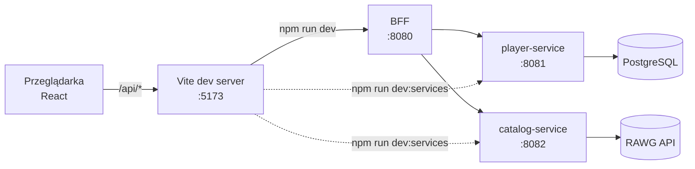

# yourGameDNA – frontend

Osobny moduł z samym frontendem: logowanie i rejestracja, wyszukiwarka gier na środku strony, profil gracza z **Game DNA**, dodawanie gier do biblioteki, edycja oceny i recenzji, usuwanie gier.

Frontend rozmawia wyłącznie z **BFF** pod `/api/...`. Dopóki BFF nie istnieje, możesz go uruchomić na udawanym backendzie albo prosto na swoich serwisach.

**Stack:** React 19 + TypeScript, Vite 8, React Router 8, TanStack Query 5, MSW 3 (mocki), Vitest. Style: CSS Modules + tokeny w `src/styles/global.css`.

## Szybki start

```bash
cd frontend
npm install
npm run dev:mock
```

Otwórz http://localhost:5173. W trybie mock działa konto demo z gotową biblioteką: `demo@yourgamedna.test` / `demo1234` (na ekranie logowania jest przycisk „Wypełnij danymi konta demo”). Możesz też założyć własne konto – wszystko zapisuje się w `localStorage` przeglądarki.

Wymagany Node **22.22+** (React Router 8).

## Tryby uruchomienia

| Komenda | Dokąd idzie `/api` | Kiedy |
|---|---|---|
| `npm run dev:mock` | nigdzie – odpowiada MSW w przeglądarce | praca nad samym UI, bez żadnego serwera |
| `npm run dev:services` | `/api/games` → catalog-service, `/api/players` → player-service; `/api/auth` emulowane w przeglądarce | **teraz** – widzisz w UI swoje prawdziwe serwisy, zanim powstanie BFF |
| `npm run dev` | całe `/api` → BFF | docelowo, gdy BFF będzie gotowy |



W trybie **services** backend nie ma jeszcze logowania, więc jest ono udawane w przeglądarce:

- rejestracja → prawdziwe `POST /players` w player-service (hasło nie jest nigdzie zapisywane),
- logowanie → szukanie gracza po emailu w `GET /players?page=&size=100`, hasło nie jest sprawdzane – możesz więc zalogować się jako gracz utworzony w Swaggerze,
- biblioteka i wyszukiwarka idą już prosto do Twoich serwisów. Jeśli endpointu jeszcze nie ma (np. `/players/{id}/library` z FEATURE-003), profil pokaże błąd 404 z podpowiedzią.

Kontrakt, który musi wystawić BFF, jest w [BFF-API.md](BFF-API.md).

## Panel Dev – podgląd tego, co robi backend

W prawym dolnym rogu (tylko w `npm run dev*`, nie ma go w buildzie produkcyjnym) jest panel z każdym żądaniem do `/api`:

- metoda, ścieżka, status, czas odpowiedzi i kto odpowiedział (`mock`, `BFF`, `player-service`, `catalog-service`),
- po kliknięciu wiersza – podgląd odpowiedzi (np. `ProblemDetail` z Twojego `GlobalExceptionHandler`),
- w trybie services widać też żądania „pod spodem”, np. `POST /auth/register` → `↳ POST /players`,
- czerwony licznik = błędy 5xx albo brak połączenia. 4xx (np. 401 z `/auth/me`, gdy nikt nie jest zalogowany) są żółte – to zwykle normalne odpowiedzi.

Gdy serwis nie działa, Vite zwraca `502` z nazwą i adresem serwisu („Brak połączenia z player-service (http://localhost:8081): ECONNREFUSED…”), więc od razu wiadomo, co uruchomić.

## Konfiguracja

Domyślne adresy są w `vite.config.ts`. Żeby je zmienić, skopiuj `.env.example` do `.env.local` (nie trafia do gita):

| Zmienna | Domyślnie | Używana w |
|---|---|---|
| `BFF_URL` | `http://localhost:8080` | `npm run dev` |
| `PLAYER_SERVICE_URL` | `http://localhost:8081` | `npm run dev:services` |
| `CATALOG_SERVICE_URL` | `http://localhost:8082` | `npm run dev:services` |
| `PORT` | `5173` | serwer Vite |

Porty serwisów wziąłem z `feat003.md` (player 8081, catalog 8082). Spring Boot bez `server.port` startuje na 8080 – wtedy ustaw `PLAYER_SERVICE_URL=http://localhost:8080`.

## Skrypty

| Skrypt | Co robi |
|---|---|
| `npm run dev` / `dev:mock` / `dev:services` | serwer deweloperski w danym trybie |
| `npm run build` | sprawdzenie typów + build produkcyjny do `dist/` (zawsze tryb BFF, bez mocków i panelu Dev) |
| `npm run preview` | podgląd builda |
| `npm run lint` | Oxlint |
| `npm test` | testy Vitest (Game DNA, parsowanie błędów, formularz biblioteki) |

## Struktura

```
src/
  api/          klient fetch + kontrakt z BFF (types.ts = DTO 1:1 z serwisami)
  app/          router, layout z nagłówkiem, React Query
  components/   wspólne UI: przyciski, pola, modal (<dialog>), okładki, odznaki statusu
  domain/       statusy gier i „geny” (kategorie ocen z FEATURE-003)
  features/
    auth/       logowanie, rejestracja, ochrona tras
    search/     strona główna z wyszukiwarką
    library/    dodawanie / edycja / usuwanie gry, lista gier w profilu
    profile/    strona profilu, edycja profilu
    dna/        obliczanie Game DNA, helisa SVG, panel DNA
  dev/          panel Dev i log żądań
  mocks/        MSW: udawany BFF (mock/) i emulacja logowania na prawdziwym player-service (services/)
```

Nowa funkcja = nowy folder w `features/`, nowe endpointy = plik w `api/`.

## Game DNA

Na razie DNA liczy frontend, z samej biblioteki (`src/features/dna/computeDna.ts`):

- **typ gracza** to gen, który najmocniej idzie w parze z oceną ogólną (korelacja Pearsona, od 3 ocenionych gier). Średnie się do tego nie nadają: mikrotransakcje w grach bez sklepu dostają zwykle 10, więc ten gen wygrywałby prawie zawsze,
- gdy żaden gen wyraźnie nie dominuje – typ „Złoty środek”; bez ocen ogólnych – najwyższa średnia genu,
- cechy (np. „Kończysz, co zaczynasz”) wynikają ze statusów i średniej oceny,
- **nić DNA**: każdy szczebel helisy to jedna gra, kolor i kształt to jej najwyżej oceniony gen. Obok jest widok tabeli.

Gdy backend zacznie generować DNA, wystarczy podmienić źródło danych w `GameDnaPanel` – typ `GameDna` może zostać kontraktem.

Status `NONE` z enuma `GameStatus` frontend pokazuje jako „Chcę zagrać” (gra dodana, jeszcze nieruszona). Takie gry nie dostają ocen.

## Dobrze wiedzieć

- **Okładki w profilu.** Pozycja biblioteki z FEATURE-003 nie ma `imageUrl`, więc profil generuje okładki z nazwy gry. Jeśli `LibraryEntry` dostanie `imageUrl` (zapisany przy dodawaniu, tak jak `gameName`), profil od razu pokaże prawdziwe obrazki.
- **„503 Mock Service Worker nie przechwycił…” w panelu Dev**, a zaraz potem to samo żądanie z 200 – to normalne. Przeglądarka czasem usypia service workera MSW (np. gdy karta długo jest w tle), a frontend uruchamia go wtedy ponownie i powtarza żądanie.
- **Reset danych mock:** przycisk „Resetuj dane mock” w panelu Dev.
- **RAWG** wymaga podpisu przy danych – link jest w stopce aplikacji.
- Moduł nie jest wpięty w `<modules>` Mavena, żeby `./mvnw clean verify` nie potrzebował Node’a. Build produkcyjny (`dist/`) może później serwować BFF albo osobny serwer.
